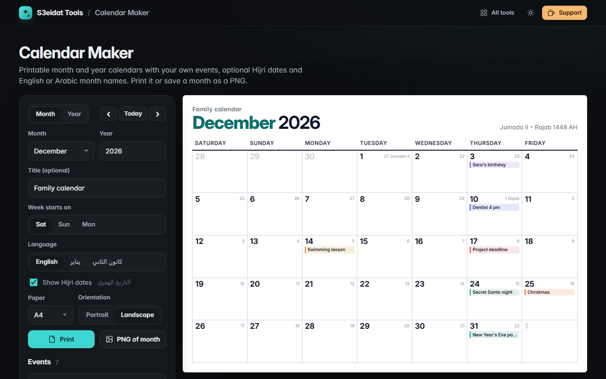

# Calendar Maker

> Printable monthly and yearly calendars with your own events and optional Hijri dates. Free, private, and it runs entirely in your browser.

### ▶ [Open Calendar Maker](https://s3eidat.github.io/calendar-maker/)



## Features

- **Month view** (big grid with room for events) and **year view** (12 mini months plus an event legend)
- **Week starts on Saturday, Sunday or Monday**
- **Hijri dates** in every day cell and the Hijri month range in the header, from the Umm al-Qura calendar built into your browser (`Intl`, islamic-umalqura)
- **English or Arabic** month and day names, either يناير… or the Levantine كانون الثاني… set, right-to-left layout, optional Arabic-Indic digits
- **Your own events** with seven colours, one-off or **every year** (birthdays, anniversaries); export and import them as JSON
- **Print** on **A4 or Letter**, **portrait or landscape**: the page is sized exactly to the paper you pick
- **PNG export** of the current month
- Optional title (e.g. "Family calendar"); settings and events are remembered in this browser

Hijri dates follow Umm al-Qura and can differ by a day from local moon sighting. No public holidays are included; add the ones you need as events.

## Privacy

Your events never leave your device. There is no server, no account, no analytics.
The page ships with a strict Content-Security-Policy (`connect-src 'self'`), so the browser
itself blocks any attempt to send data anywhere.

## Run it yourself

It's plain HTML, CSS and JavaScript with no build step:

```bash
git clone https://github.com/s3eidat/calendar-maker
cd calendar-maker
python -m http.server 8000
```

Then open http://localhost:8000.

## Support

If this saved you time, **[buy me a coffee ☕](https://s3eidat.github.io/coffee/)**. It keeps every tool free.

---

Part of **[S3eidat Tools](https://s3eidat.github.io/)**: 100+ free, private tools that run in your browser. MIT licensed.
